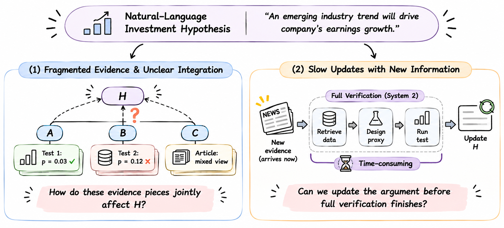
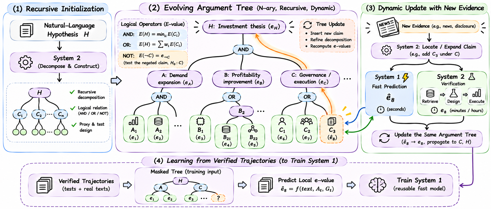
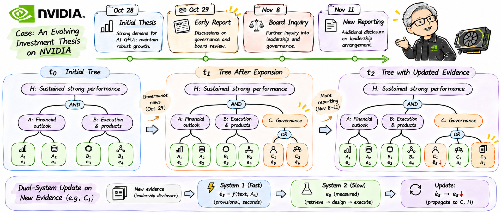

# Arguments as Growing Trees

**Can Models Learn to Assess Investment Hypotheses from Evolving Evidence?**

Public demonstration code accompanying a research proposal on recursive argument construction and asynchronous evidence verification. The prototype uses preloaded source excerpts, registered datasets, and replaceable provider interfaces. System 1 includes a training entry point but remains **untrained**.

- [Recorded operating-proxy demo](demo/index.html): real Qwen planning and executed statistical tests.
- [Dynamic governance case](demo/governance/index.html): a six-stage storyboard, labeled **planned / incomplete coverage**.
- Download the repository and open either HTML file directly to view a replay without an API.
- Live Qwen runs require an accessible endpoint. The campus service used for validation is available only from the authorized HPC network.

**Validation:** the latest scenario code passed `compileall` and 54 CPU unit tests on HPC2. The governance storyboard made no API calls. See the [Boolean validation record](docs/boolean-aggregation-validation.md) for live Qwen evidence and the [governance case notes](docs/dynamic-governance-case.md) for its implementation scope.

## Research motivation

The starting point is an **unverified natural-language investment hypothesis, a reference time, a horizon, and an accessible data environment**. System 2 recursively constructs claims, logical relationships, and executable proxy tests. Executing those tests produces verification trajectories.



## Method overview

The argument tree organizes construction, verification, and subsequent updates. System 1 would learn from reviewed text-test pairs in completed historical trajectories; initialization does not require pre-existing verification records or retraining for each new tree.

During operation, System 2 attaches new text and its target claim, invokes System 1 for a local prediction, and continues background verification. A measured result replaces the same local evidence slot, and the tree recomputes affected ancestors. System 1 currently returns `null`; path masking controls information leakage rather than defining an ancestor-prediction objective.



## Dynamic case

The NVIDIA storyboard illustrates initialization, governance-driven expansion, and subsequent evidence updates. It preserves source attribution, event relationships, and incomplete proxy coverage.



## Quick start

The offline demo requires Python 3.10+ and runs on CPU without an API or GPU. Project integration and campus API validation were performed on authorized HPC hosts; GitHub hosts the code only.

```bash
python -m pip install -e .
python -m unittest discover -s tests -v
python -m agt.cli demo --backend fixture --scenario investment --output runs/investment
python -m agt.cli serve --directory runs/investment --port 8765
```

Open <http://127.0.0.1:8765>, or open `runs/investment/index.html` directly. The self-contained page includes stage snapshots and clickable tree nodes with execution records.

The `fixture` backend is deterministic offline orchestration, explicitly labeled `offline-fixture`. Its statistical tools execute actual SciPy calculations.

To generate the governance storyboard:

```bash
python -m agt.governance --output runs/governance
python -m agt.cli serve --directory runs/governance --port 8765
```

That storyboard uses supplied materials and planned proxy tasks. It does not report completed governance tests or successful initialization of a fully verified tree.

## Live Qwen System 2

Configure the variables listed in [.env.example](.env.example) in an environment authorized to access the endpoint. The application reads environment variables; it does not automatically load `.env` files or log keys and credential-bearing URLs.

```bash
export AGT_QWEN_BASE_URL='https://your-authorized-endpoint/v1'
export AGT_QWEN_MODEL='Qwen/Qwen3.8-27B'
export AGT_QWEN_LEDGER='/absolute/hpc/path/task-api-ledger.jsonl'
# If needed, inject AGT_QWEN_API_KEY through an existing secret manager.
python -m agt.cli demo --backend qwen --scenario investment \
  --hypothesis "NVIDIA's business outlook will improve over the next quarter" \
  --reference-time "2024-02-22T00:00:00+00:00" \
  --horizon "The next fiscal quarter" \
  --output runs/qwen-investment
```

A typical run has three planning phases: initialization, attachment, and verification. Retries are bounded; the CLI permits at most 12 requests per run, with at most 3,000 output tokens per request. The model is never silently substituted. Use a fresh output directory to preserve previous records.

The client uses `trust_env=False`. If required, set the client-specific `AGT_QWEN_PROXY`; avoid changing global proxy settings. GreenCloud dispatches tasks, while checkouts, dependencies, execution logs, and results remain on HPC.

Validation campaigns use a shared, fresh `AGT_QWEN_LEDGER` across runs: at most 16 requests, a conservative output budget of 48,000 tokens, and 25 minutes from the first request. Each attempt reserves its budget before dispatch, including transport failures. Schema repair and execution or coverage repair are tracked separately. Full responses and logs remain in the authorized execution environment.

## Demo lifecycle and data

| Stage | Behavior |
| --- | --- |
| Initialization | System 2 proposes claims and proxy tests; every committed initial branch terminates in executed test records. |
| New evidence | System 2 selects a claim and attaches the new claim/text records. |
| Immediate update | System 1 receives the full tree with affected-path numerical fields masked; the untrained adapter returns `null`. |
| Background verification | Registered tools execute tests and record p-values and converted e-values. |
| Measured replacement | The measured value replaces the same local slot; fixed Boolean expressions recompute ancestors while earlier snapshots remain available. |
| Duplicate event | Event and source-lineage identifiers identify repeated reports without creating independent statistical contributions. |

The `investment` replay initializes on February 22, 2024 using four FY2024 quarters. Data containing FY2025 Q1 becomes available on May 23, 2024. The releases were published on February 21 and May 22; the demo conservatively uses the following UTC day as availability, rather than claiming minute-level reconstruction. See [SOURCES.md](SOURCES.md) for the reported values.

Pearson correlation between revenue and quarter index is a small-sample observational proxy. Serial dependence is uncorrected, and results retain `requires_review`. The demo covers this historical proxy, not a verified forecast, causal effect, investment return, or root probability. Expression arithmetic may be displayed as provisional.

The `discovery` scenario uses an official DiscoveryBench count table and executes a contingency-table test:

```bash
python -m agt.cli demo --scenario discovery --output runs/discovery
```

This is a dataset subset, not a reproduction of the complete POPPER benchmark. Its runtime event is a labeled source-review fixture that revisits the same table, rather than historical news.

## Executable proxy initialization

The code follows this sequence:

```text
scenarios.py   Registered catalog and actual column types
prompts.py     Versioned planning instructions
planning.py    JSON and schema parsing
proxy.py       Proxy, method, and data checks
statistics.py CPU test execution
tree.py        Structure and claim-to-leaf traceability
engine.py      Validated candidate commit
```

Proxy specifications record the target claim, measured quantity, entity, period, unit, column mapping, data availability, test, null and alternative hypotheses, polarity, sample requirements, assumptions, and parent-child relevance. The planner selects registered data and tools; it cannot supply its own p-values or e-values.

Initialization plans, validates or repairs, executes, checks structure and coverage, and then commits a successful snapshot. Intermediate claims are permitted, but every committed branch must reach an executed leaf. Empty tests, dangling branches, invalid columns, constant series, duplicate observations, and future data are rejected. Failed candidates remain in execution logs rather than appearing as successful trees.

The registered `testable_claim` identifies the proposition assessed by a tool. Pearson supports an explicit two-sided nonzero-correlation alternative; its result cannot be relabeled as a one-sided test. Evidence links use `context` until their interpretation is reviewed. Executability, semantic equivalence, and statistical validity have separate statuses.

Coverage retains the original hypothesis, operationalized scope, uncovered aspects, and completeness. Missing aspects are not inserted as pending leaves in a successfully initialized tree. Initial trees contain claims and testable evidence; textual evidence enters during runtime.

Provider contracts and acquisition scope are documented in [V5 scope](docs/v5-scope.md). Source excerpts are preloaded, not automatically collected. Broader acquisition remains an adapter extension.

## Boolean e-value aggregation

The tree uses one [Boolean evaluator](agt/aggregation.py). A local e-value for claim `C` targets `H0 = NOT C`.

| Operator | Rule | Parent null |
| --- | --- | --- |
| AND | Minimum of child e-values | Union of child nulls |
| OR | Prespecified nonnegative weighted average, with weights summing to one | Intersection of child nulls |
| NOT | Test the opposite proposition using the corresponding polarity | Defined by that opposite proposition |

AND and OR do not require independent inputs. NOT propagates polarity through the expression using De Morgan's laws and looks up a separately defined opposite-polarity test. Missing tests return `pending`; the evaluator never takes a reciprocal or flips a numerical score. An OR introduced by a negated AND requires explicit preset `negation_weights`.

Expressions retain versions, original wording, scope, review status, and applicability conditions. Additional evidence updates the same local slot. Changing a logical condition requires a new expression version and explicit semantic review. Predictions, adaptive selection, and incomplete semantic, null, or statistical review produce provisional scores. Fixed-snapshot rules do not establish validity under optional stopping.

Prespecified weighted averaging under arbitrary dependence is supported by [Wang (2025), Biometrika 112(2), asaf020](https://doi.org/10.1093/biomet/asaf020). The AND rule follows because the minimum is bounded by each child whose null holds. Sequential multiplication remains isolated in [popper_history.py](agt/popper_history.py) for the historical POPPER protocol; the tree engine does not import it.

The independent p-to-e implementation uses POPPER's fixed `kappa = 0.5` conversion, `e = 0.5 / sqrt(p)`. Records retain p, e, nulls, and data hashes. Valid e-values require valid p-values; execution alone does not establish the test's assumptions or the proxy's relationship to its parent.

## System 1 learning resources

The learning target is **one local log e-value conditioned on a target claim, the complete current tree, real text, source metadata, and publication/reference times**. The same text can have different evidence meanings for different claims.

`training.jsonl` contains candidate reviewed-pair resources, not initialization inputs. Only runtime texts uniquely aligned with completed tests are exported; initial tests do not automatically become training examples. Missing or ambiguous matches are recorded in `pairing_notes`.

```bash
python -m agt.train runs/investment/training.jsonl
```

This command validates the data only. Empty pairing returns `empty_pairing`. No training or weight download has been performed, and System 1 remains untrained.

Inputs preserve tree structure and unaffected context while masking local results, all ancestor numerical values, duplicate or same-family data results and their ancestors, predictions, slots, aggregate payloads, and execution logs. Regression targets only one executed local log e-value. Text must preserve the material available before the target result; external corpora require independent leakage checks and grouped source splits.

Future experiments would test full-tree context, heterogeneous supervision, uncertainty and probability calibration with appropriate labels, update accuracy, and measured-feedback gains. Time-dependent evidence retention remains future work without an additional training target in this version.

## Code guide

| File | Responsibility |
| --- | --- |
| `agt/tree.py` | Nodes, expressions, versions, and time |
| `agt/engine.py` | Orchestration, asynchronous verification, revision checks, and deduplication |
| `agt/qwen.py` | API client and bounded planning calls |
| `agt/prompts.py` | Versioned planning and repair prompts |
| `agt/planning.py` | Structured-plan parsing |
| `agt/proxy.py` | Proxy specifications and registered-data validation |
| `agt/statistics.py` | Allowlisted CPU statistical tests |
| `agt/boolean.py` | Boolean expression validation |
| `agt/aggregation.py` | Recursive numerical evaluation |
| `agt/system1.py` | Joint leakage masking and the untrained local predictor |
| `agt/train.py` | Pair validation and optional training entry point |
| `agt/providers.py` | Replaceable evidence and dataset interfaces |
| `agt/scenarios.py` | Registered operating and DiscoveryBench scenarios |
| `agt/governance.py` | Planned governance storyboard |
| `agt/web/` | Replay interfaces |

The executor runs allowlisted tools rather than arbitrary model-generated Python. Revision checks prevent stale background work from overwriting newer trees. Automatic replanning of stale work remains a future extension.

## Reproducing HPC CPU checks

After checking out a fixed commit on an authorized HPC host, run with the existing environment:

```bash
PYTHON=/path/to/existing/venv/bin/python \
  bash scripts/check-cpu.sh /absolute/hpc/path/new-check-evidence
```

This runs `compileall`, unit tests, the investment fixture, and pair validation without API calls or training. Full outputs remain on HPC. GitHub Actions workflows have been removed and remain disabled.

Additional execution records: [proxy initialization](docs/proxy-initialization-validation.md), [Boolean aggregation](docs/boolean-aggregation-validation.md), and [dynamic governance case](docs/dynamic-governance-case.md).
